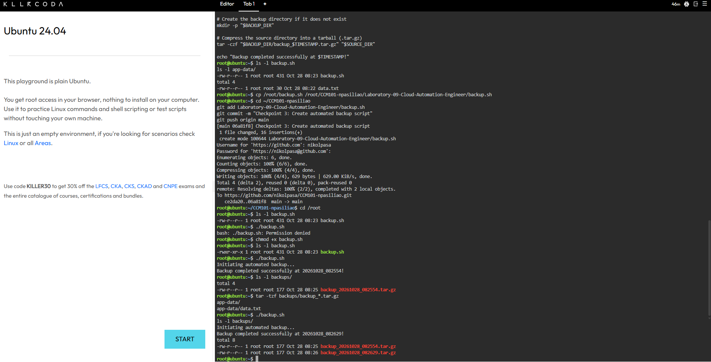
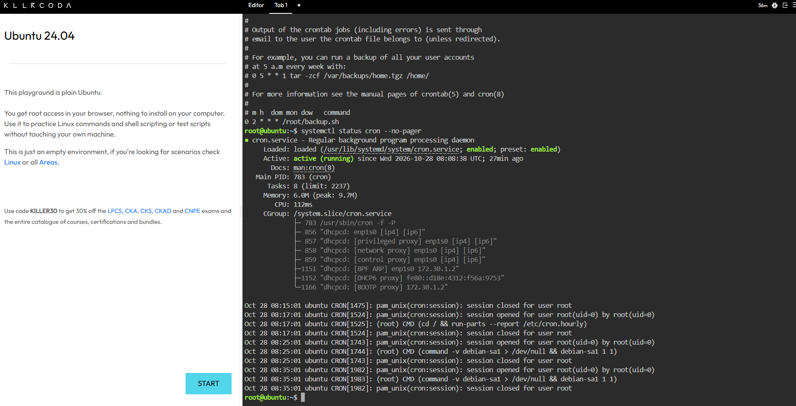

# Laboratory Activity 9: Cloud Automation Engineer

## Mission Overview

In this laboratory activity, I explored how automation can simplify cloud administration. Acting as a Cloud Automation Engineer at CloudNova Technologies, I created a Bash script to compress application data and configured Linux Cron to schedule automated backups.

The activity demonstrates how repetitive tasks can be completed through scripts instead of requiring manual execution.

## Objectives

- Understand the fundamentals of Bash scripting.
- Use variables to manage directory paths and timestamps.
- Create and save Bash scripts using Nano.
- Modify file permissions using chmod.
- Execute and verify automated backup scripts.
- Configure scheduled tasks using Linux Cron.
- Document automation procedures using Markdown.

## Tools Used

- KillerCoda Ubuntu Playground
- Linux Terminal
- Bash Shell
- Nano Text Editor
- Linux Cron
- Git and GitHub
- Markdown

## Commands Executed

### Creating Application Data

```bash
mkdir -p app-data
echo "This is critical client data." > app-data/data.txt
```

### Creating the Bash Script

```bash
nano backup.sh
```

### Modifying File Permissions

```bash
chmod +x backup.sh
```

### Executing the Backup

```bash
./backup.sh
```

### Verifying the Backup

```bash
ls -l backups/
```

### Configuring Cron

```bash
crontab -l
env EDITOR=nano crontab -e
```

### Scheduled Backup Expression

```cron
0 2 * * * /root/backup.sh
```

This expression schedules the backup script every day at 2:00 AM using the server's timezone.

## Skills Learned

- Writing and understanding Bash scripts.
- Using variables and timestamps in automation.
- Managing Linux executable permissions.
- Creating compressed backup archives.
- Understanding Cron scheduling syntax.
- Automating repetitive administrative tasks.
- Documenting technical procedures.
- Managing project files using GitHub.

## Screenshot Evidence

### Script Execution



### Cron Schedule



## Conclusion

This mission helped me understand how automation supports cloud operations by making repetitive tasks easier to manage. Bash scripting and Cron scheduling provide a foundation for building more reliable and efficient cloud administration processes.
